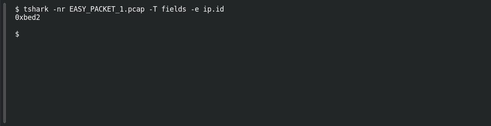

# EASY PACKET 1 #09 — Packet Identity

**Platform:** PCGCTF · **Challenge ID:** 91 · **Category:** Network Forensics · **Points:** 100

**Status:** Answer backed by the capture (`EASY_PACKET_1.pcap`). Exact PCGCTF submission not re-confirmed.

**Evidence:** Packet 1 · TCP stream 0 · [EASY_PACKET_1.pcap](../../challenges/solved/network-forensics/082-easy-packet-1-the-exposed-request/files/EASY_PACKET_1.pcap).

## The challenge

Recover the IPv4 identification value.

## Solving it

```sh
tshark -nr EASY_PACKET_1.pcap -T fields -e ip.id
```

```text
0xbed2
```

tshark shows it as hex `0xbed2`; the challenge wants decimal, which is 48850.

## Screenshot

Fresh local reproduction using the command described above.



## Flag

```text
pcgCTF{48850}
```

## Reference

- [Original challenge description](../../challenges/solved/network-forensics/091-easy-packet-1-09-packet-identity/README.md)
