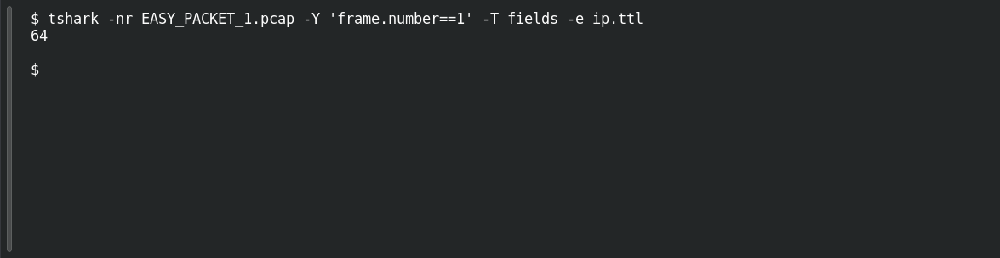

# EASY PACKET 1 #10 — TTL: 64 Hops

**Platform:** PCGCTF · **Challenge ID:** 92 · **Category:** Network Forensics · **Points:** 100

**Status:** Solved in the authenticated snapshot. I re-pulled the field from the capture for this writeup.

**Evidence:** Packet 1 · TCP stream 0 · [EASY_PACKET_1.pcap](../../challenges/solved/network-forensics/082-easy-packet-1-the-exposed-request/files/EASY_PACKET_1.pcap).

## The challenge

Read the IPv4 TTL out of the packet. The evidence is `EASY_PACKET_1.pcap` — the same capture the rest of this Easy Packet series uses (SHA-256 `e4735559…394faa`).

## Solving it

TTL is the time-to-live field — the remaining hop count the packet is carrying. One quick note: it's what's *left*, not how many hops it has already crossed, unless you know the sender's starting value.

I read the field straight out of frame 1 with tshark:

```sh
tshark -nr EASY_PACKET_1.pcap -Y 'frame.number==1' -T fields -e ip.ttl
```

```text
64
```

So the answer is 64. No OS-fingerprinting or path-length guessing needed — the question just asks for the value.

## Screenshot

Fresh local reproduction using the command described above.



## Flag

```text
pcgCTF{64}
```

## Takeaway

Report the TTL you actually see before reading anything into it. 64 is a common Linux default, but the packet doesn't prove that on its own.

## References

- [Original challenge description](../../challenges/solved/network-forensics/092-easy-packet-1-10-ttl-64-hops/README.md)
- [tshark field output](../evidence/network/092-fields.tsv)
- [Earlier local solution](../../challenges/solved/network-forensics/092-easy-packet-1-10-ttl-64-hops/solution.md)
