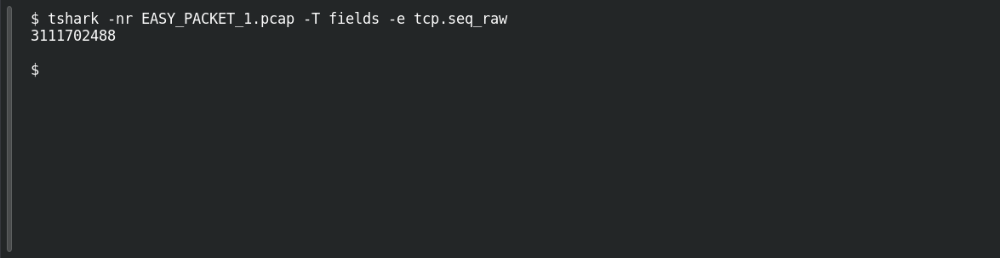

# EASY PACKET 1 #16 — TCP Sequence Marker

**Platform:** PCGCTF · **Challenge ID:** 98 · **Category:** Network Forensics · **Points:** 100

**Status:** Solved in the authenticated snapshot; field re-pulled from the capture for this writeup.

**Evidence:** Packet 1 · TCP stream 0 · [EASY_PACKET_1.pcap](../../challenges/solved/network-forensics/082-easy-packet-1-the-exposed-request/files/EASY_PACKET_1.pcap).

## The challenge

Recover the raw TCP sequence number. The evidence is `EASY_PACKET_1.pcap`, the shared capture for this whole series.

## Solving it

```sh
tshark -nr EASY_PACKET_1.pcap -T fields -e tcp.seq_raw
```

```text
3111702488
```

I used `tcp.seq_raw` to get the absolute value rather than Wireshark's relative sequence number.

## Screenshot

Fresh local reproduction using the command described above.



## Flag

```text
pcgCTF{3111702488}
```

## Reference

- [Original challenge description](../../challenges/solved/network-forensics/098-easy-packet-1-16-tcp-sequence-marker/README.md)
