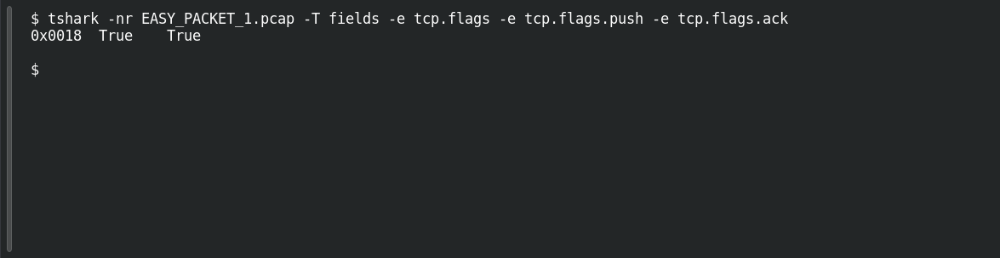

# EASY PACKET 1 #18 — Push and Acknowledge

**Platform:** PCGCTF · **Challenge ID:** 100 · **Category:** Network Forensics · **Points:** 100

**Status:** Answer backed by the capture (`EASY_PACKET_1.pcap`). Exact PCGCTF submission not re-confirmed.

**Evidence:** Packet 1 · TCP stream 0 · [EASY_PACKET_1.pcap](../../challenges/solved/network-forensics/082-easy-packet-1-the-exposed-request/files/EASY_PACKET_1.pcap).

## The challenge

Identify the TCP flags set.

## Solving it

```sh
tshark -nr EASY_PACKET_1.pcap -T fields -e tcp.flags -e tcp.flags.push -e tcp.flags.ack
```

```text
0x0018	True	True
```

Flags 0x018 = PSH + ACK — a data segment that also acknowledges.

## Screenshot

Fresh local reproduction using the command described above.



## Flag

```text
pcgCTF{PSH and ACK}
```

## Reference

- [Original challenge description](../../challenges/solved/network-forensics/100-easy-packet-1-18-push-and-acknowledge/README.md)
