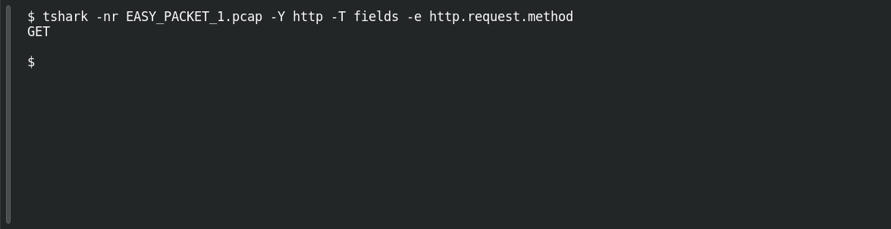

# EASY PACKET 1 #22 — GET the Resource

**Platform:** PCGCTF · **Challenge ID:** 104 · **Category:** Network Forensics · **Points:** 100

**Status:** Solved in the authenticated snapshot; field re-pulled from the capture for this writeup.

**Evidence:** Packet 1 · TCP stream 0 · [EASY_PACKET_1.pcap](../../challenges/solved/network-forensics/082-easy-packet-1-the-exposed-request/files/EASY_PACKET_1.pcap).

## The challenge

Identify the HTTP request method. The evidence is `EASY_PACKET_1.pcap`, the shared capture for this whole series.

## Solving it

```sh
tshark -nr EASY_PACKET_1.pcap -Y http -T fields -e http.request.method
```

```text
GET
```

## Screenshot

Fresh local reproduction using the command described above.



## Flag

```text
pcgCTF{GET}
```

## Reference

- [Original challenge description](../../challenges/solved/network-forensics/104-easy-packet-1-22-get-the-resource/README.md)
