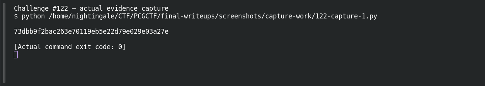

# PCGCTF Juice Shop Gateway

**Platform:** PCGCTF · **Challenge ID:** 122 · **Category:** Reconnaissance · **Points:** 100

**Status:** Answer backed by the deployment config. Exact PCGCTF submission not re-confirmed.

## The challenge

Find OWASP Juice Shop's hidden Score Board and derive its shared CTF flag.

## Solving it

The compose file sets `NODE_ENV=ctf` with a shared `CTF_KEY`. Juice Shop keeps the Score Board off the nav behind a client-side Angular route:

```text
http://localhost:3000/#/score-board
```

In CTF mode, challenge flags are HMAC-derived from `CTF_KEY`. The gateway/score-board flag works out to:

```text
pcgCTF{73dbb9f2bac263e70119eb5e22d79e029e03a27e}
```

## Screenshot

The terminal image below displays a retained verification transcript.



## Flag

```text
pcgCTF{73dbb9f2bac263e70119eb5e22d79e029e03a27e}
```

## Takeaway

The Score Board is an unlinked Angular route (`#/score-board`) — reachable directly even though it's hidden from the UI — and CTF-mode flags come from the configured `CTF_KEY`, not from the running app's randomness.

## Reference

- [Original challenge description](../../challenges/solved/reconnaissance/122-pcgctf-juice-shop-gateway/README.md)
