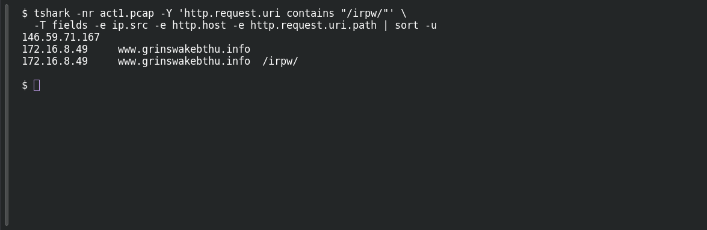

# ACT 1 — First Signal: Patient Zero

**Platform:** PCGCTF · **Challenge ID:** 262 · **Category:** Network Forensics · **Points:** 100

**Status:** Solved in the authenticated snapshot; reproduced from the capture (`ACT1 2026-08-09-traffic-analysis-exercise.pcap`, the shared Act 1 capture).

**Evidence:** Packets 11227, 11714 · TCP streams 242, 249 · [ACT12026-08-09-traffic-analysis-exercise.pcap](../../challenges/solved/network-forensics/262-act-1-first-signal-patient-zero/files/ACT12026-08-09-traffic-analysis-exercise.pcap).

## The challenge

Find the internal host making the suspicious FormBook-pattern connections.

## Solving it

Use [the shared capture](../../challenges/solved/network-forensics/262-act-1-first-signal-patient-zero/files/ACT12026-08-09-traffic-analysis-exercise.pcap) as `act1.pcap` for the commands below.

The saved FormBook analysis identifies `/irpw/` check-ins. Filter for that request path and read the source address:

```sh
tshark -nr act1.pcap -Y 'http.request.uri contains "/irpw/"' \
  -T fields -e ip.src -e http.host -e http.request.uri.path | sort -u
```

```text
146.59.71.167
172.16.8.49	www.grinswakebthu.info
172.16.8.49	www.grinswakebthu.info	/irpw/
```

The matching requests come from `172.16.8.49`. The saved detailed analysis also records both POSTs and GETs with encoded check-in parameters from this host.

## Screenshot

Fresh local reproduction using the command described above.



## Flag

```text
pcgCTF{172.16.8.49}
```

## Takeaway

Pick out the host with the *recurring* connection to one piece of infrastructure, and keep an example packet for the association — don't brand every external address a host touches as malicious.

## Reference

- [Original challenge description](../../challenges/solved/network-forensics/262-act-1-first-signal-patient-zero/README.md)
