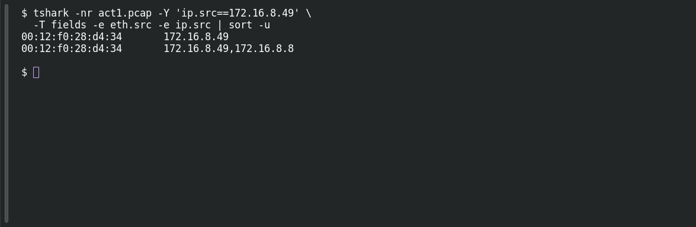

# ACT 1 — First Signal: Hardware Fingerprint

**Platform:** PCGCTF · **Challenge ID:** 263 · **Category:** Network Forensics · **Points:** 100

**Status:** Solved in the authenticated snapshot; reproduced from the Act 1 capture.

**Evidence:** Packet 1884 · UDP stream 46 · [ACT12026-08-09-traffic-analysis-exercise.pcap](../../challenges/solved/network-forensics/262-act-1-first-signal-patient-zero/files/ACT12026-08-09-traffic-analysis-exercise.pcap).

## The challenge

Tie the victim IP (172.16.8.49) to its Ethernet MAC address.

## Solving it

Use [the shared capture](../../challenges/solved/network-forensics/262-act-1-first-signal-patient-zero/files/ACT12026-08-09-traffic-analysis-exercise.pcap) as `act1.pcap` for the commands below.

Read the Ethernet and IP source fields together for the previously identified victim:

```sh
tshark -nr act1.pcap -Y 'ip.src==172.16.8.49' \
  -T fields -e eth.src -e ip.src | sort -u
```

```text
00:12:f0:28:d4:34	172.16.8.49
00:12:f0:28:d4:34	172.16.8.49,172.16.8.8
```

The source MAC is `00:12:f0:28:d4:34`. The saved identity analysis also associates it with a local broadcast from the workstation.

## Screenshot

Fresh local reproduction using the command described above.



## Flag

```text
pcgCTF{00:12:f0:28:d4:34}
```

## Takeaway

Read the source IP and source MAC from one frame — don't stitch values together from unrelated packets, and don't mistake a destination MAC for the host's.

## Reference

- [Original challenge description](../../challenges/solved/network-forensics/263-act-1-first-signal-hardware-fingerprint/README.md)
