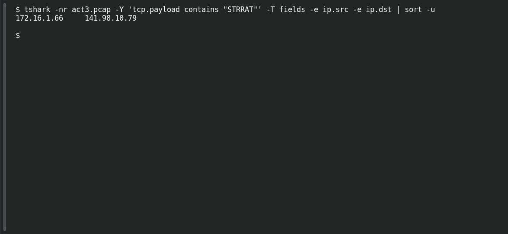

# ACT 3 — Malware Investigation: Compromised Endpoint

**Platform:** PCGCTF · **Challenge ID:** 274 · **Category:** Network Forensics · **Points:** 100

**Status:** Answer backed by the Act 3 capture. Exact PCGCTF submission not independently re-confirmed.

**Evidence:** Packet 9119 · TCP stream 83 · [2024-07-30-traffic-analysis-exercise.pcap](../../challenges/solved/network-forensics/274-act-3-malware-investigation-compromised-endpoint/files/2024-07-30-traffic-analysis-exercise.pcap).

## The challenge

Identify the infected client in the STRRAT incident.

## Solving it

Use [the shared capture](../../challenges/solved/network-forensics/274-act-3-malware-investigation-compromised-endpoint/files/2024-07-30-traffic-analysis-exercise.pcap) as `act3.pcap` for the commands below.

STRRAT's beacon is a cleartext pipe-delimited string carried in the TCP payload, literally starting `ping|STRRAT|...`. Searching for it:

```sh
tshark -nr act3.pcap -Y 'tcp.payload contains "STRRAT"' -T fields -e ip.src -e ip.dst | sort -u
```

```text
172.16.1.66	141.98.10.79
```

The host sending the beacon is 172.16.1.66 (talking to the C2 at 141.98.10.79).

## Screenshot

Fresh local reproduction using the command described above.



## Flag

```text
pcgCTF{172.16.1.66}
```

## Takeaway

STRRAT doesn't bother encrypting its check-in — the family name is right there in the payload, which makes finding patient zero trivial.

## Reference

- [Original challenge description](../../challenges/solved/network-forensics/274-act-3-malware-investigation-compromised-endpoint/README.md)
