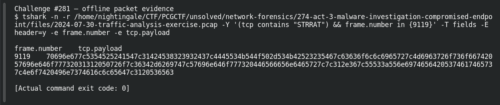

# ACT 3 — Malware Investigation: Beacon Evidence

**Platform:** PCGCTF · **Challenge ID:** 281 · **Category:** Network Forensics · **Points:** 100

**Status:** Answer backed by the Act 3 capture. Exact PCGCTF submission not independently re-confirmed.

**Evidence:** Packet 9119 · TCP stream 83 · [2024-07-30-traffic-analysis-exercise.pcap](../../challenges/solved/network-forensics/274-act-3-malware-investigation-compromised-endpoint/files/2024-07-30-traffic-analysis-exercise.pcap).

## The challenge

Read the hostname leaked inside the STRRAT beacon.

## Solving it

Same decoded beacon as #276 — the hostname is the fourth pipe-delimited field:

```text
ping|STRRAT|1BE8292C|DESKTOP-SKBR25F|ccollier|Microsoft Windows 11 Pro|...
```

So the leaked hostname is `DESKTOP-SKBR25F`.

## Screenshot

The terminal image below displays a retained verification transcript.



## Flag

```text
pcgCTF{DESKTOP-SKBR25F}
```

## Takeaway

One decode of the STRRAT check-in gives host, user, OS and AV in order — this question is just a different field of the same string.

## Reference

- [Original challenge description](../../challenges/solved/network-forensics/281-act-3-malware-investigation-beacon-evidence/README.md)
