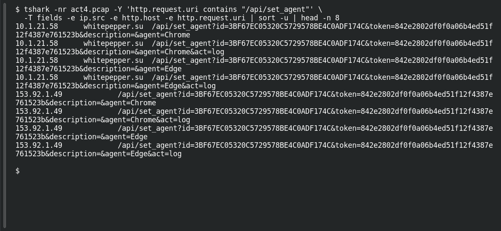

# ACT 4 — Lumma in the Room: Lumma Victim

**Platform:** PCGCTF · **Challenge ID:** 282 · **Category:** Network Forensics · **Points:** 100

**Status:** Answer backed by the Act 4 capture. Exact PCGCTF submission not independently re-confirmed.

**Evidence:** Packets 24500, 25270 · TCP streams 99, 111 · [2026-01-31-traffic-analysis-exercise.pcap](../../challenges/solved/network-forensics/282-act-4-lumma-in-the-room-lumma-victim/files/2026-01-31-traffic-analysis-exercise.pcap).

## The challenge

Identify the client sending Lumma victim-fingerprinting requests.

## Solving it

Use [the shared capture](../../challenges/solved/network-forensics/282-act-4-lumma-in-the-room-lumma-victim/files/2026-01-31-traffic-analysis-exercise.pcap) as `act4.pcap` for the commands below.

Lumma registers victims via `/api/set_agent` calls. Filtering those shows one source host:

```sh
tshark -nr act4.pcap -Y 'http.request.uri contains "/api/set_agent"' \
  -T fields -e ip.src -e http.host -e http.request.uri | sort -u | head -n 8
```

```text
10.1.21.58	whitepepper.su	/api/set_agent?id=3BF67EC05320C5729578BE4C0ADF174C&token=842e2802df0f0a06b4ed51f12f4387e761523b&description=&agent=Chrome
10.1.21.58	whitepepper.su	/api/set_agent?id=3BF67EC05320C5729578BE4C0ADF174C&token=842e2802df0f0a06b4ed51f12f4387e761523b&description=&agent=Chrome&act=log
10.1.21.58	whitepepper.su	/api/set_agent?id=3BF67EC05320C5729578BE4C0ADF174C&token=842e2802df0f0a06b4ed51f12f4387e761523b&description=&agent=Edge
10.1.21.58	whitepepper.su	/api/set_agent?id=3BF67EC05320C5729578BE4C0ADF174C&token=842e2802df0f0a06b4ed51f12f4387e761523b&description=&agent=Edge&act=log
153.92.1.49		/api/set_agent?id=3BF67EC05320C5729578BE4C0ADF174C&token=842e2802df0f0a06b4ed51f12f4387e761523b&description=&agent=Chrome
153.92.1.49		/api/set_agent?id=3BF67EC05320C5729578BE4C0ADF174C&token=842e2802df0f0a06b4ed51f12f4387e761523b&description=&agent=Chrome&act=log
153.92.1.49		/api/set_agent?id=3BF67EC05320C5729578BE4C0ADF174C&token=842e2802df0f0a06b4ed51f12f4387e761523b&description=&agent=Edge
153.92.1.49		/api/set_agent?id=3BF67EC05320C5729578BE4C0ADF174C&token=842e2802df0f0a06b4ed51f12f4387e761523b&description=&agent=Edge&act=log
```

The victim is 10.1.21.58, posting fingerprints to `whitepepper.su`.

## Screenshot

Fresh local reproduction using the command described above.



## Flag

```text
pcgCTF{10.1.21.58}
```

## Takeaway

Lumma's `set_agent` registration (with the same victim `id` token repeated across browsers) is a clean fingerprint for the infected host.

## Reference

- [Original challenge description](../../challenges/solved/network-forensics/282-act-4-lumma-in-the-room-lumma-victim/README.md)
