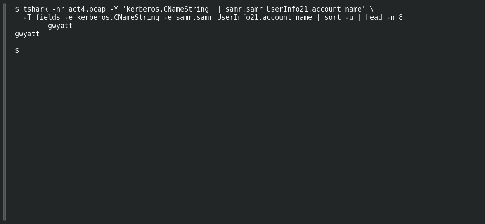

# ACT 4 — Lumma in the Room: Compromised User

**Platform:** PCGCTF · **Challenge ID:** 285 · **Category:** Network Forensics · **Points:** 100

**Status:** Answer backed by the Act 4 capture. Exact PCGCTF submission not independently re-confirmed.

**Evidence:** Packets 214, 358 · TCP streams 4, 8 · [2026-01-31-traffic-analysis-exercise.pcap](../../challenges/solved/network-forensics/282-act-4-lumma-in-the-room-lumma-victim/files/2026-01-31-traffic-analysis-exercise.pcap).

## The challenge

Find the user account tied to the Lumma client.

## Solving it

Use [the shared capture](../../challenges/solved/network-forensics/282-act-4-lumma-in-the-room-lumma-victim/files/2026-01-31-traffic-analysis-exercise.pcap) as `act4.pcap` for the commands below.

Kerberos from the victim and a SAMR record agree:

```sh
tshark -nr act4.pcap -Y 'kerberos.CNameString || samr.samr_UserInfo21.account_name' \
  -T fields -e kerberos.CNameString -e samr.samr_UserInfo21.account_name | sort -u | head -n 8
```

```text
gwyatt
gwyatt
```

The account is `gwyatt`.

## Screenshot

Fresh local reproduction using the command described above.



## Flag

```text
pcgCTF{gwyatt}
```

## Takeaway

Kerberos CNameString from the victim's IP + a matching SAMR record is the standard one-two for user attribution.

## Reference

- [Original challenge description](../../challenges/solved/network-forensics/285-act-4-lumma-in-the-room-compromised-user/README.md)
