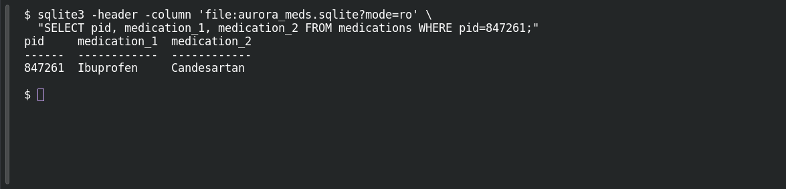

# SQL Skillz

**Platform:** PCGCTF · **Challenge ID:** 311 · **Category:** Aurora Patient Zero · **Points:** 100

**Status:** Solved in the last snapshot; reproduced from the extracted database.

## The challenge

Query the Aurora iOS app's local medication database for the current patient's medication (the one that isn't Ibuprofen).

## Solving it

The IPA contains `Payload/aurora-patient-portal.app/aurora_meds.sqlite`, an unencrypted SQLite database. Its `medications` table has two medication columns for each patient.

Using patient ID `847261` from the previous challenge, read the row without changing the database:

```sh
sqlite3 -header -column 'file:aurora_meds.sqlite?mode=ro' \
  "SELECT pid, medication_1, medication_2 FROM medications WHERE pid=847261;"
```

The row lists `Ibuprofen` and `Candesartan`. The question asks for the medication other than Ibuprofen, so the answer is `Candesartan`.

## Screenshot

Fresh local reproduction using the command described above.



## Flag

```text
deadface{Candesartan}
```

## Takeaway

A mobile app's "local database" is often just an unencrypted SQLite file sitting in the bundle — open it read-only and query it like any other DB.

## Reference

- [Original challenge and attachments](../../challenges/solved/aurora-patient-zero/311-sql-skillz/README.md)
