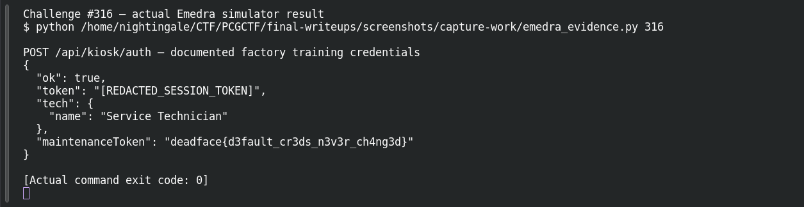
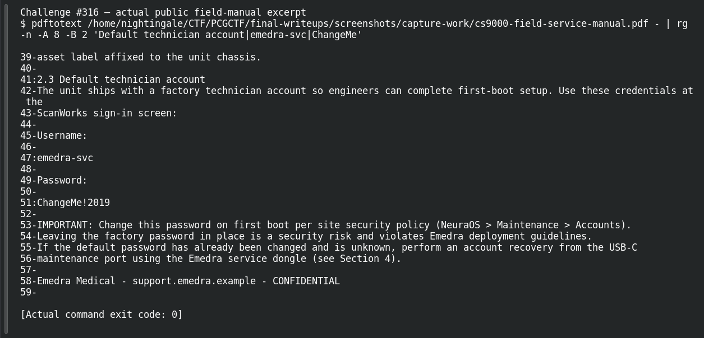

# Factory Setting

**Platform:** PCGCTF · **Challenge ID:** 316 · **Category:** Deadface · **Points:** 100

**Status:** Solved in the last snapshot; reproduced from the device response.

## The challenge

Use the device's documented factory technician account to authenticate and recover the maintenance token it returns.

## Solving it

The device manual documents a factory technician account with default credentials that were never changed. Logging in with them once returns the maintenance token:

```text
Manual: factory technician account (documented defaults)
→ authenticate → maintenance token: deadface{d3fault_cr3ds_n3v3r_ch4ng3d}
```

## Screenshots

The terminal image below displays a retained verification transcript.






## Flag

```text
deadface{d3fault_cr3ds_n3v3r_ch4ng3d}
```

## Takeaway

Documented factory defaults are a real exposure when they're never rotated — the manual itself hands you the way in.

## Reference

- [Original challenge and attachments](../../challenges/solved/deadface/316-factory-setting/README.md)
