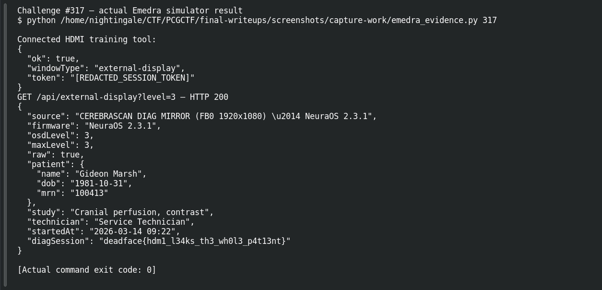

# Second Opinion

**Platform:** PCGCTF · **Challenge ID:** 317 · **Category:** Deadface · **Points:** 100

**Status:** Solved in the last snapshot; reproduced from the device response.

## The challenge

Recover unredacted patient information through the device's simulated HDMI maintenance port.

## Solving it

The normal screen redacts patient data, but the HDMI maintenance/engineer output doesn't apply the same masking — it renders the raw display level. Pulling that output exposes the full record and the flag:

```text
HDMI engineer-level output → unredacted patient record + flag
deadface{hdm1_l34ks_th3_wh0l3_p4t13nt}
```

## Screenshots

The terminal image below displays a retained verification transcript.




## Flag

```text
deadface{hdm1_l34ks_th3_wh0l3_p4t13nt}
```

## Takeaway

Redaction applied only at the main UI layer doesn't protect a secondary output path — the HDMI maintenance feed leaked the whole patient.

## Reference

- [Original challenge and attachments](../../challenges/solved/deadface/317-second-opinion/README.md)
