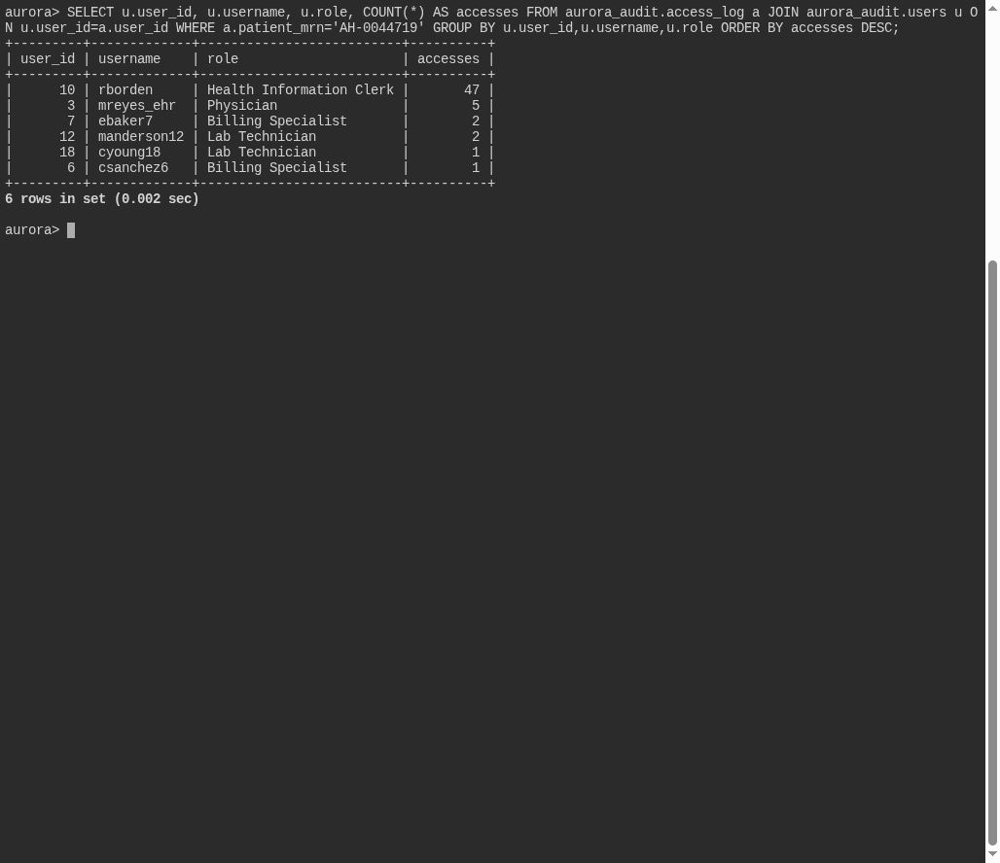

# Prying Eyes

**Platform:** PCGCTF · **Challenge ID:** 329 · **Category:** Deadface · **Points:** 100

**Status:** Solved in the saved snapshot. The query and screenshots below come from the saved database verification.

## The challenge

Count accesses to the VIP's chart and identify the account with the most.

## Solving it

I grouped the access-log rows for the VIP's chart by account and ordered by count:

```sql
SELECT u.user_id, u.username, u.role, COUNT(*) AS accesses
FROM aurora_audit.access_log a
JOIN aurora_audit.users u ON u.user_id=a.user_id
WHERE a.patient_mrn='AH-0044719'
GROUP BY u.user_id,u.username,u.role
ORDER BY accesses DESC;
```

The top account is `rborden` — the one snooping the chart most.

## Screenshot



## Flag

Selected result from the saved verification:

```text
deadface{rborden}
```

## Takeaway

Access logs make insider snooping a simple GROUP BY / ORDER BY — the account at the top of the count is the answer.

## Reference

- [Original challenge and attachments](../../challenges/solved/deadface/329-prying-eyes/README.md)
