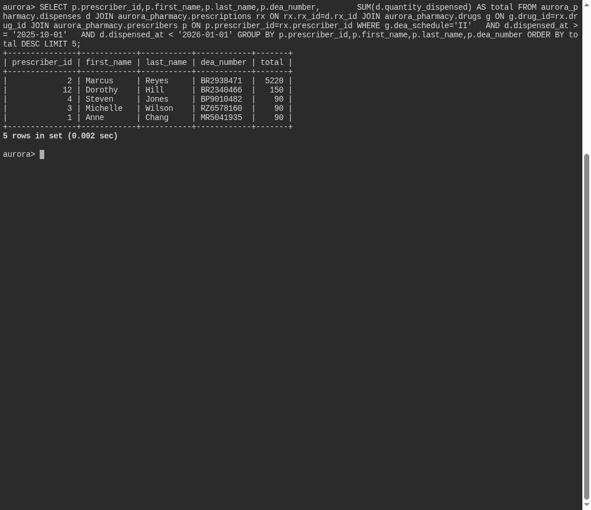

# Heavy Hand

**Platform:** PCGCTF · **Challenge ID:** 331 · **Category:** Deadface · **Points:** 100

**Status:** Solved in the saved snapshot. The query and screenshots below come from the saved database verification.

## The challenge

Rank prescribers by total quantity of Schedule II drugs dispensed in Q4 2025, and report the leading prescriber's DEA number.

## Solving it

I joined dispenses to the drug table, filtered to Schedule II in the final quarter, summed quantity per prescriber, and took the top one:

```sql
SELECT p.prescriber_id,p.first_name,p.last_name,p.dea_number,
       SUM(d.quantity_dispensed) AS total
FROM aurora_pharmacy.dispenses d
JOIN aurora_pharmacy.prescriptions rx ON rx.rx_id=d.rx_id
JOIN aurora_pharmacy.drugs g ON g.drug_id=rx.drug_id
JOIN aurora_pharmacy.prescribers p ON p.prescriber_id=rx.prescriber_id
WHERE g.dea_schedule='II'
  AND d.dispensed_at >= '2025-10-01'
  AND d.dispensed_at < '2026-01-01'
GROUP BY p.prescriber_id,p.first_name,p.last_name,p.dea_number
ORDER BY total DESC
LIMIT 5;
```

Top prescriber's DEA number: `BR2938471`.

## Screenshot



## Flag

Selected result from the saved verification:

```text
deadface{BR2938471}
```

## Takeaway

Aggregate on quantity (not prescription count), bound the quarter with a half-open range, and return the DEA number the question asks for.

## Reference

- [Original challenge and attachments](../../challenges/solved/deadface/331-heavy-hand/README.md)
