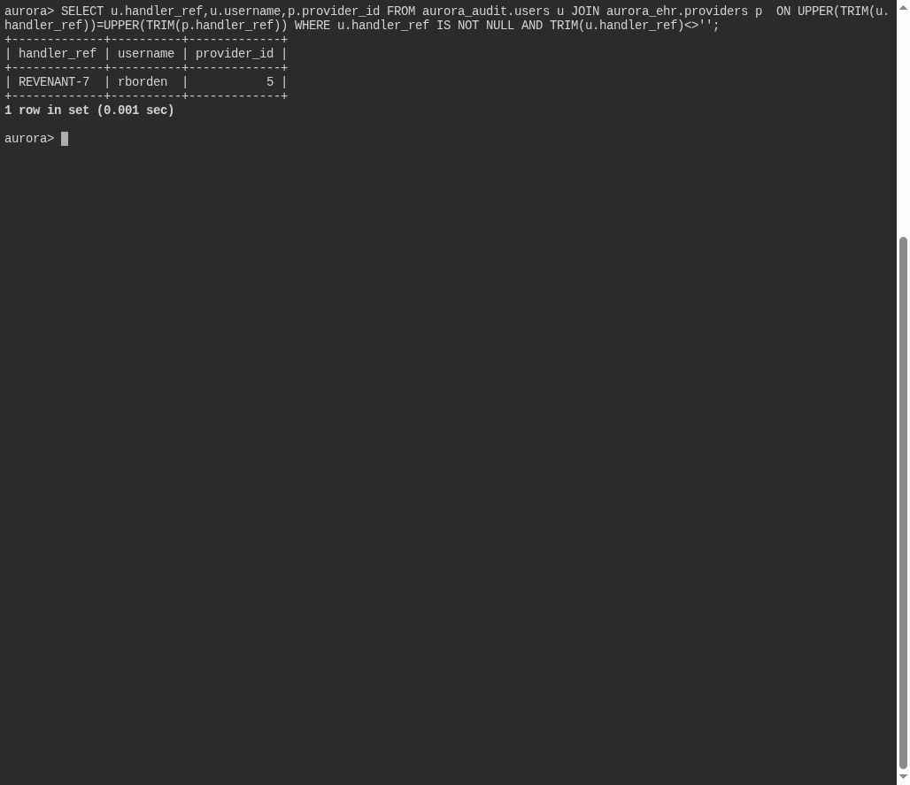

# Upon the Throne

**Platform:** PCGCTF · **Challenge ID:** 332 · **Category:** Deadface · **Points:** 100

**Status:** Solved in the saved snapshot. The query and screenshots below come from the saved database verification.

## The challenge

Find the handler codename that appears in both the audit users and the EHR providers, and submit that shared codename.

## Solving it

Both tables carry a `handler_ref`, so I joined on it (trimmed and case-normalized, excluding blanks) to find the codename linking an audit account to a provider:

```sql
SELECT u.handler_ref,u.username,p.provider_id
FROM aurora_audit.users u
JOIN aurora_ehr.providers p
 ON UPPER(TRIM(u.handler_ref))=UPPER(TRIM(p.handler_ref))
WHERE u.handler_ref IS NOT NULL AND TRIM(u.handler_ref)<>'';
```

Selected result from the saved verification:

```text
REVENANT-7
```

The codename links audit account `rborden` and provider 5 — but the flag is the shared codename, not either username.

## Screenshot



## Flag

```text
deadface{REVENANT-7}
```

## Takeaway

Trim and case-normalize before joining on a reference field, and exclude blank placeholders so empty strings don't match each other.

## Reference

- [Original challenge and attachments](../../challenges/solved/deadface/332-upon-the-throne/README.md)
