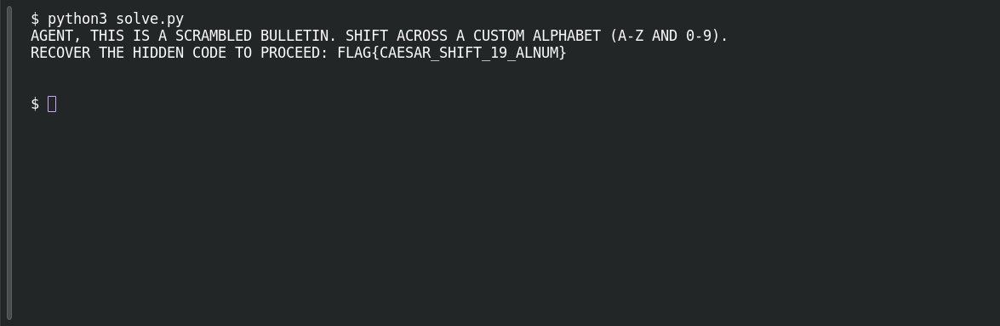

# Rotation 36

**Platform:** PCGCTF · **Challenge ID:** 18 · **Category:** Cryptography · **Points:** 100

**Status:** Rejected Flag — under investigation. Shift 19 produces readable text and a flag-shaped payload, but the recorded submission variants were rejected. No accepted string is known.

## The challenge

A Caesar shift over a custom 36-character alphabet (`A–Z` plus `0–9`). Recover the hidden code.

## Solving it

The attachment defines the ring as `ABCDEFGHIJKLMNOPQRSTUVWXYZ0123456789` — so the position after `Z` is `0`, and digits rotate too. I decoded by rotating back 19 and verified by re-encrypting (`+19`) and checking the whole file matches:

Save this as `solve.py` and run `python3 solve.py`. [Download the script](../scripts/018-solve.py).

```python
from pathlib import Path

alphabet = "ABCDEFGHIJKLMNOPQRSTUVWXYZ0123456789"
ciphertext = Path("cipher.txt").read_text()

def rotate(text, shift):
    result = []
    for character in text:
        letter = character.upper()
        if letter in alphabet:
            result.append(alphabet[(alphabet.index(letter) + shift) % 36])
        else:
            result.append(character)
    return "".join(result)

plaintext = rotate(ciphertext, -19)
assert rotate(plaintext, 19) == ciphertext
print(plaintext)
```

```text
AGENT, THIS IS A SCRAMBLED BULLETIN. SHIFT ACROSS A CUSTOM ALPHABET (A-Z AND 0-9).
RECOVER THE HIDDEN CODE TO PROCEED: FLAG{CAESAR_SHIFT_19_ALNUM}
```

The round-trip checks that this implementation reverses the transformation, including whitespace. It does not establish which shift the challenge intended; the readable instructions support trying shift 19.

## Screenshot

Fresh local reproduction using the command described above.



## Flag — rejected, unresolved

The decoded payload is `FLAG{CAESAR_SHIFT_19_ALNUM}`, but submissions failed:

| Candidate | Outcome | Evidence |
|---|---|---|
| `pcgCTF{CAESAR_SHIFT_19_ALNUM}` | Incorrect | user screenshot in chat (original image no longer on disk) |
| `FLAG{CAESAR_SHIFT_19_ALNUM}` | Rejected | user report |
| `pcgCTF{caesar_shift_19_alnum}` | Incorrect | prior assistant test |

The cipher is case-insensitive, so the original capitalization can't be recovered from the math alone — that may be the issue, or the served attachment may differ from the archived one.

## Still to do

- Re-run the script against the *currently served* attachment and compare its SHA-256 with the archived round-trip record.
- Pull the live hint / required format, and ask the organizer for clarification rather than guessing more variants.

## Takeaway

A readable decode and a reversible implementation do not establish that the grader accepts the resulting string. The rejection remains unresolved.

## Reference

- [Original challenge description](../../challenges/unsolved/cryptography/018-rotation-36/README.md)
