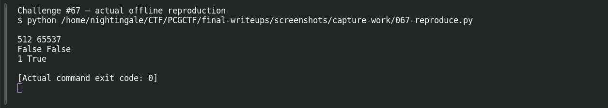

# Weak RSA

**Platform:** PCGCTF · **Challenge ID:** 67 · **Category:** Cryptography · **Points:** 300

**Status:** Unresolved. The math is standard once `n` is factored, but I didn't recover a factor of this 512-bit modulus in a bounded effort, so there's no plaintext or flag. (Flag format is lowercase `pcgctf{...}`.)

## The challenge

Textbook RSA with `e = 65537` and a weak key generation. The job: factor `n`, rebuild `d`, decrypt `c`.

## Working it

First, what the parameters actually are — `65537` is the *exponent*, not the key size. The modulus here is only **512 bits**, which is weak by modern standards. For two-prime RSA, factoring `n = p·q` gives everything: `φ = (p-1)(q-1)`, `d = e⁻¹ mod φ`, `m = c^d mod n`.

I ran the structural sanity checks (composite, not a perfect square, `gcd(c,n)=1`, `c` a valid residue) — all consistent, none of which hands over a factor. Then the actual factoring attempts:

```text
Fermat (close primes):      no factor
Pollard p−1:                no factor
ECM (500 curves, B1=50k):   no factor
pairwise GCD vs other moduli: no shared factor
FactorDB:                   status C (composite), no factors on record
```

So the modulus stays unfactored within those bounds — and a bound only rules out what it tested, it doesn't prove the key is strong.

The solver is ready for the moment a factor turns up (it verifies `p·q == n` and re-encrypts to check `pow(m,e,n)==c`):

```python
q = n // p
d = pow(e, -1, (p-1)*(q-1))
m = pow(c, d, n)
assert p*q == n and pow(m, e, n) == c
```

## Screenshot

The terminal image below displays a retained verification transcript.



## Flag

Not recovered — the modulus isn't factored yet.

## Still to do

- A properly resourced general factoring run (larger ECM / a dedicated factorer against a 512-bit modulus), or a new FactorDB record, then feed the verified prime into the solver above.

## Takeaway

Knowing the RSA equations isn't the same as having the key material. And `e=65537` says nothing about security — a 512-bit modulus is the actual weakness here.

## Reference

- [Original challenge description](../../challenges/unsolved/cryptography/067-weak-rsa/README.md)
