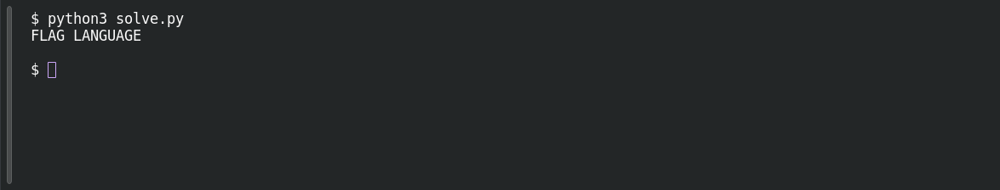

# Sequence

**Platform:** PCGCTF · **Challenge ID:** 79 · **Category:** Cryptography / Encoding · **Points:** 100

**Status:** Answer backed by the reproduced decode. Exact PCGCTF submission not re-confirmed.

## The challenge

Recover a two-word message selected by a mathematical sequence.

## Solving it

The signature names Leonardo Bonacci and includes `+011235813213455`, pointing to Fibonacci numbers. Use the distinct 1-based positions `1, 2, 3, 5, 8, 13, 21, 34`.

The six opening sentences start with `F L A S G W`. Positions 1, 2, 3 and 5 spell `FLAG`. The final sentence asks to “start the maths again,” so restart the positions at the JSON block.

Keep the JSON keys in their source order, including nested keys. Positions 1, 2, 3, 5, 8, 13, 21 and 34 select `Location`, `Accept`, `No-cache`, `Gui`, `User-agent`, `Alt-svc`, `Gateway` and `Expires`. Their initials spell `LANGUAGE`.

Save this as `solve.py` beside `sequence.txt` and run `python3 solve.py`. [Download the script](../scripts/079-solve.py).

```python
from pathlib import Path
import re

text = Path("sequence.txt").read_text()
positions = [1, 2, 3, 5, 8, 13, 21, 34]
prose = text.split("{", 1)[0]
sentences = [part.strip() for part in re.split(r"\.\s*", prose)
             if part.strip()]
first_word = "".join(sentences[i - 1][0] for i in positions
                     if i <= len(sentences))
json_text = text[text.index("{"):text.rindex("}") + 1]
keys = re.findall(r'^\s*"([^"\n]+)"\s*:', json_text, re.M)
second_word = "".join(keys[i - 1][0] for i in positions)
print(first_word, second_word)
```

```text
FLAG LANGUAGE
```

## Screenshots

Fresh local reproduction using the command described above.



## Flag

```text
pcgCTF{FLAG LANGUAGE}
```

## Takeaway

When a sequence indexes a structure, preserve the structure's original order (JSON key order here) — re-sorting it silently would select the wrong characters.

## Reference

- [Original challenge description](../../challenges/unsolved/cryptography-encoding/079-sequence/README.md)
