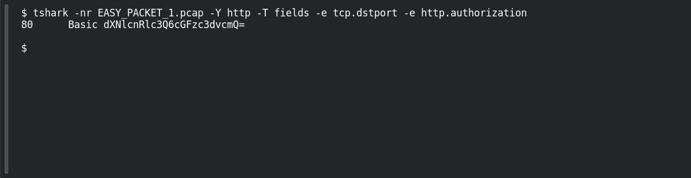

# EASY PACKET 1 #30 — Cleartext on the Wire

**Platform:** PCGCTF · **Challenge ID:** 112 · **Category:** Network Forensics · **Points:** 100

**Status:** Technically solved, but the exact accepted wording is unresolved — short variants were rejected.

**Evidence:** Packet 1 · TCP stream 0 · [EASY_PACKET_1.pcap](../../challenges/solved/network-forensics/082-easy-packet-1-the-exposed-request/files/EASY_PACKET_1.pcap).

## The challenge

Explain the credential-exposure weakness and the transport fix.

## Solving it

Two things together make the weakness. The request carries HTTP Basic auth, and it's plain HTTP:

```sh
tshark -nr EASY_PACKET_1.pcap -Y http -T fields -e tcp.dstport -e http.authorization
```

Basic auth is just Base64 of `usertest:password` — reversible, not encrypted — and it's sent over port 80 with no TLS, so anyone with the capture reads the credentials. The fix is transport encryption: **HTTPS/TLS**. Base64 provides none ([RFC 7617](https://www.rfc-editor.org/rfc/rfc7617.html)).

## Screenshot

Fresh local reproduction using the command described above.



## Flag

No confirmed flag. The issue (cleartext Basic auth over HTTP) and the remedy (HTTPS/TLS) are clear, but the teammate's short variants were rejected and the grader's exact phrase isn't known.

## Still to do

- Pull the live prompt/hint to see whether the grader wants a combined explanation, a single label, or specific wording.

## Takeaway

The weakness is the *combination* — reversible Base64 credentials plus an unencrypted transport. Naming Base64 alone misses the point; the fix is TLS.

## Reference

- [Original challenge description](../../challenges/unsolved/network-forensics/112-easy-packet-1-30-cleartext-on-the-wire/README.md)
